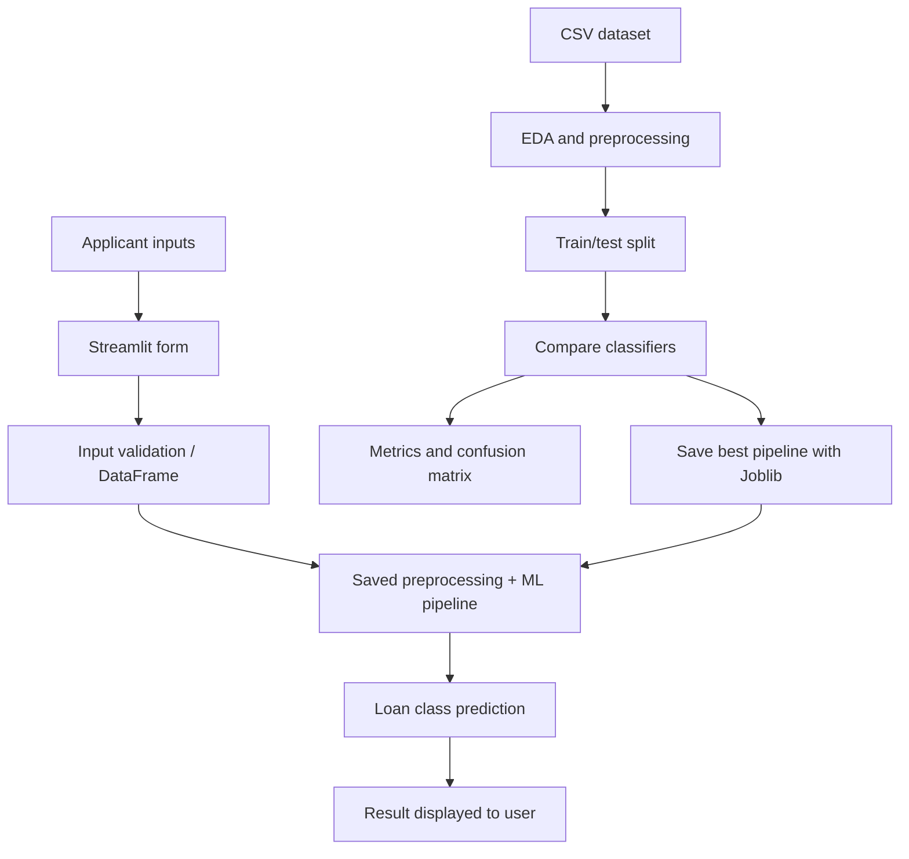
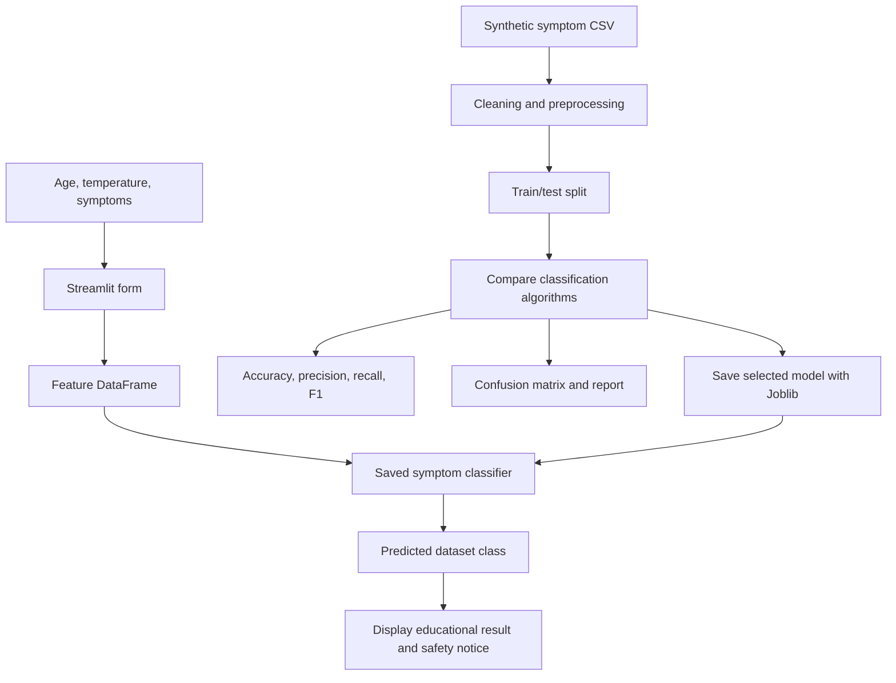

# Architecture and Flowcharts

## Loan Approval System Architecture

## Disease Prediction System Architecture

## Explanation
Each project has two workflows. The training workflow cleans data, separates features and target, splits the dataset, trains multiple algorithms, compares evaluation metrics and serializes the selected complete pipeline. The prediction workflow collects user input, passes it through the saved pipeline and displays the predicted class. The preprocessing steps are stored inside the loan pipeline so the same transformations are applied at prediction time.
